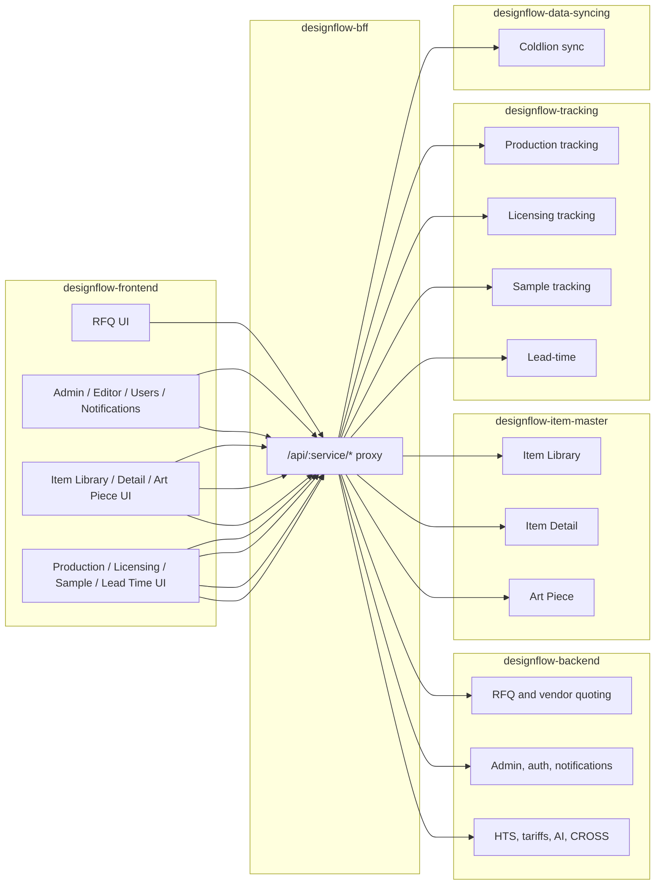

# Designflow Feature Dependency Matrix

> This matrix records application dependencies, not business authority. Start with the [companywide application and task map](https://github.com/u2giants/shared-db/blob/main/docs/business-rules/application-map.md) for business meaning.

This matrix maps major user-facing and system-facing features to frontend
modules, API gateway prefixes, backend services, route groups, shared data, and
external dependencies.

The target audience is an engineer trying to answer: "If this feature changes,
which repos and services should I inspect first?"

## Matrix

| Feature | Frontend area / service consumer | BFF prefix | Primary service | Main route groups | Data touched | External dependencies |
|---|---|---|---|---|---|---|
| Authentication: password / legacy account flows | `pages/auth`, `MainService`, auth guards/interceptors | `/api/core` | `designflow-backend` | `/signup`, `/verifyAuthToken`, `/forgotPassw`, `/changePassword`, `/findUserLoginInfo` | `users`, `vendor`, auth token tables | Brevo for email flows |
| Authentication: Microsoft SSO | `AzureSsoService`, `auth-redirect.html`, auth pages | `/api/core` | `designflow-backend` | `/auth/azure` | `users`, `vendor` | Microsoft Azure AD JWKS |
| JWT propagation and service ingress | `UserAuthInterceptor` | all `/api/:service` paths | `designflow-bff` plus all private services | `/api/:service/*` | none directly | Google Cloud Run OIDC |
| Role-based navigation and route protection | Angular route guards, `app.component.ts`, toolbar/menu | all | frontend plus service auth middleware | `authRole([...])` in service routers | `users`, `Roles`, `RolePermissions`, `UIElements` | none |
| Admin impersonation | `ImpersonationService`, Manage Users UI, toolbar banner | `/api/core` | `designflow-backend` | `/api/admin/impersonate/:userId` | `users`, `vendor`, `Factory` | JWT signing keys |
| RFQ grid load | `pages/rfq`, `MainService` | `/api/core` | `designflow-backend` | `/getAllItem`, `/getRFQViewlayout`, `/getCustomGridLayout`, `/getGridDefaultView` | `RFQItem`, `RFQVendor`, `RFQGroup`, `GridLayout`, `GridViewState`, `viewlayout` | none |
| RFQ item editing | `pages/rfq`, AG Grid value setters | `/api/core` | `designflow-backend` | `/updateRfqItem`, `/addRfqItem`, `/deleteRFQItem`, `/archiveRFQItem` | `RFQItem`, `RFQGroup`, audit/log tables | none |
| RFQ vendor quote editing | RFQ detail renderer, vendor screens | `/api/core` | `designflow-backend` | `/updateVendor`, `/addingVendor`, `/deleteRFQItemVendor`, `/selectedVendor`, `/addMultipleVendor` | `RFQVendor`, `vendor`, `Factory` | Brevo for notifications/emails |
| RFQ quote requests and re-quotes | RFQ grid/detail, vendor flows | `/api/core` | `designflow-backend` | `/sendPriceReq`, `/sendMultiplePriceReq`, `/requestRequote`, `/keepPrice` | `RFQVendor`, `quote_auth_token`, `user_notification` | Brevo |
| RFQ factory management | RFQ vendor assignment UI | `/api/core` | `designflow-backend` | `/searchFactories`, `/listFactories`, `/getVendorGroups`, `/addVendorGroup`, `/updateFactoryGroup`, `/removeFactoryFromGroup`, `/reorderGroupFactories` | `Factory`, `vendor`, `vendorGroup` | none |
| RFQ calculations | `pages/rfq/helpers/equation.ts`, value setters | mostly frontend, persist through `/api/core` | frontend plus `designflow-backend` persistence | `/updateRfqItem`, `/updateVendor` | `RFQItem`, `RFQVendor` calculated columns | none |
| Duty-rate and HTS classification | `HtsClassifierService`, duty-rate dialog, `AiSettingsService`, `CrossService` | `/api/core` | `designflow-backend` | `/api/openrouter/models`, `/api/openrouter/chat`, `/api/cross/search`, `/api/admin/hts-rates/lookup`, `/api/admin/section301/*`, `/api/admin/trump2025/*`, `/api/admin/ai-cache-stats` | `app_settings`, `ai_cache_events`, bundled `data/hts-rates.json`, `Factory.factory_country` | OpenRouter, DeepSeek, Alibaba Qwen, CBP CROSS, USITC snapshot source |
| HTS job availability and status | `HtsClassificationJobsService`, `HtsClassificationJobsStore`, global tray | `/api/core` | `designflow-backend` | `/api/hts-rag/jobs/attention-summary`, `/api/hts-rag/jobs*` | `HtsRagClassificationJob`; disabled summary avoids job reads | Cloud Tasks for enabled worker, not summary polling |
| Factory country auto-fill | RFQ sub-grid helper, admin settings UI | `/api/core` | `designflow-backend` | `/api/admin/factories`, `/api/admin/factories/countries`, `/api/admin/factories/:id` | `Factory.factory_country` | none |
| Standardized Products | `pages/standardized`, `StdService` | `/api/core` | `designflow-backend` | `/std/*` | `Standardized*` tables, `RFQItem` on export/import | Brevo for quote requests where used |
| Item Library | `pages/itemLibrary`, `ItemLibraryService` | `/api/item_master` | `designflow-item-master` | `/lib/getAllitems`, `/lib/getViewlayout`, `/lib/createItem`, `/lib/getItemTypes`, `/lib/getItemByNumber` | `itemHeader`, `itemDetail`, `itemAttachment`, item type/product category data | DigitalOcean Spaces for media paths |
| Item Detail | `pages/itemDetail`, `ItemDetailService` | `/api/item_master` | `designflow-item-master` | `/detail/getItemInfo`, `/detail/updateData`, `/detail/updateItemHeader`, `/detail/assignments/*`, `/detail/*LicensingStatus*` | `itemHeader`, `itemDetail`, `licensingStatus`, item assignment tables | DigitalOcean Spaces for attachments |
| Art Piece management | `pages/art_piece` / Art Piece UI, `ArtPieceService` | `/api/item_master` | `designflow-item-master` | `/artPiece/getAllitems`, `/artPiece/getArtPiece/:id`, `/artPiece/createItem`, `/artPiece/updateArtPiece`, `/artPiece/addAttachment/:id` | Art piece/item header/detail/attachment data | DigitalOcean Spaces |
| Production tracking | `pages/prod_tracking`, `TrackingService` | `/api/tracking` | `designflow-tracking` | `/getProdOrderHeader`, `/getViewlayout/:grid_id`, `/updateProdOrderHeader` | `ProdOrderHeader`, `ProdOrderDetail`, grid layout tables, item/order associations | none |
| Factory production order updates | vendor production tracking UI, `TrackingService` | `/api/tracking` | `designflow-tracking` | `/factoryProdOrders`, `/factoryProdOrderDates` | `ProdOrderHeader`, `ProdOrderDetail`, factory/vendor associations | none |
| Production prepack association sync | production UI/system action | `/api/tracking` and `/api/data_sync` | `designflow-tracking`, `designflow-data-syncing` | `/syncPrepackAssociations` | `item_prod_order_detail_associations`, production order detail/header | Coldlion through data-sync path |
| Licensing tracking | `pages/licensing_tracking`, `LicensingTrackingService` | `/api/tracking` | `designflow-tracking` | `/lic/getLic`, `/lic/updateLic`, `/lic/statuses`, `/lic/images`, `/lic/groups` | `itemHeader`, `itemDetail`, `licensingStatus`, `licensingMilestone`, `LicenseFeedBacks`, `itemLicenseImage`, `groups` | DigitalOcean Spaces for images |
| Lead-time calculator | `pages/lead_time_calculator`, `LeadTimeService` | `/api/tracking` | `designflow-tracking` | `/lead-time/design-team-times`, `/lead-time/licensing-times`, `/lead-time/factory-times`, `/lead-time/calculate` | `DesignTeamTime`, `LicensingTime`, `FactoryTime`, `merchGroup` | none |
| Sample tracking | `pages/sample_tracking`, `TrackingService` sample methods, customer autocomplete via `itemService.getCustomers()` | `/api/tracking`, `/api/core` | `designflow-tracking`, `designflow-backend` | `/sample/list`, `/sample/:id`, `/sample/customer`, `/sample/events`, `/sample/comments`, `/sample/groups`, `/sample/boxes`, `/sample/photos`, `/sample/shipments`, `/findCustomers` | `sample`, `sample_event`, `sample_comments`, `sample_attachment`, `sample_factory_group`, `sample_box`, `sample_shipment`, `sample_shipment_item`, `sample_shipment_notice`, `sample_shipment_notice_recipient`, existing `customers` and `users` | DigitalOcean Spaces for photos; courier tracking links; Brevo shipment-list email |
| Customer administration | customer/admin screens, `CustomerService` | `/api/core` | `designflow-backend` | `/api/customers`, `/api/grid/access-level/customer`, `/getPreSignedUrl`, `/setObjectPublic` | `customers`, `GridAccessLevel` | DigitalOcean Spaces for logos |
| Item size/depth administration | editor/admin screens, `ItemSizeService`, `ItemDepthService` | `/api/core` | `designflow-backend` | `/api/item-size`, `/api/item_depth` | `itemSize`, `itemDepth`, grid access metadata | none |
| Admin master data | Editor/Admin UI, `AdminService` | `/api/core` | `designflow-backend` | `/api/admin/getArtTypes`, `/api/admin/getArtists`, `/api/admin/getAgeGroups`, `/api/admin/getMerchGroupCategories`, `/api/admin/updateMerchGroup` | `ArtTypes`, `ArtistTypes`, `Artist`, `AgeGroup`, `merchGroup` | none |
| App settings | Editor/Admin UI, `AiSettingsService` and related admin screens | `/api/core` | `designflow-backend` | `/api/admin/app-settings/:key` | `app_settings` | OpenRouter/tariff behavior may depend on settings |
| Notifications | Toolbar, notifications page, comments mention picker, `NotificationService` | `/api/core` | `designflow-backend` | `/api/notifications`, `/api/notifications/count`, `/api/notifications/mentionable-users`, `/api/comment/addComment` | `user_notification`, `comments`, `users` | none |
| Comments and mentions | comments components, item/detail/RFQ contexts | `/api/core` | `designflow-backend` | `/api/comment/*` | `comments`, `user_notification`, `users` | none |
| Profile photos | toolbar/user profile UI, `UserProfileService`, `MainService` | `/api/core` | `designflow-backend` | `/api/user/me`, `/api/user/photo` | `users.profile_photo`, `vendor.vendor_profile_photo` | DigitalOcean Spaces |
| General file upload / tech links | shared upload components, `MainService`, `HelperService` | `/api/core` plus some item-master paths | `designflow-backend`, `designflow-item-master` | `/getPreSignedUrl`, `/setObjectPublic`, `/saveTechLink/:id`, `/deleteBucketObjects`, item-master attachment routes | `itemAttachment`, file URL fields | DigitalOcean Spaces |
| Grid layout/access/view state | RFQ, tracking, licensing, item library, editor | `/api/core`, `/api/item_master`, `/api/tracking` depending feature | multiple | `/saveGridLayout`, `/getCustomGridLayout`, `/api/grid/access-level/*`, `/getSelectedGridView`, `/getViewlayout/:grid_id` | `GridLayout`, `GridChildrenLayout`, `GridChildrenLayoutOrder`, `GridAccessLevel`, `GridViewState`, `viewlayout` | none |
| Coldlion item sync | sync UI/system caller, `SyncService` for streaming merch group path | `/api/data_sync` | `designflow-data-syncing` | `/getItemHeaderFromCL`, `/getItemDetailFromCL`, `/getItem`, `/streamMerchgroupDetailFromCL` | `itemHeader`, `itemDetail`, `merchGroup`, sync helper models | Coldlion |
| Coldlion production/vendor/customer sync | system caller | `/api/data_sync` | `designflow-data-syncing` | `/getProdOrderHeader`, `/getProdOrderDetail`, `/getExternalVendor`, `/getExternalCustomer`, `/syncPrepackAssociations` | production order tables, external vendor/customer tables, prepack associations | Coldlion |
| Health checks | Cloud Run / uptime checks | `/health` on BFF; `/api/<service>/api/health` through BFF or direct local service health | all services | `/health`, `/api/health` | none | Cloud Run health/monitoring |

## Service Ownership By Feature Family

## Change Impact Guide

| You are changing... | Inspect first | Also inspect |
|---|---|---|
| A visible RFQ calculation | `designflow-frontend/src/app/pages/rfq`, `designflow-frontend/src/app/pages/rfq/helpers` | `designflow-backend/routes/lib.router.js`, RFQ model mapping helpers |
| RFQ persistence or vendor quote behavior | `designflow-backend/models/lib.model.js`, `designflow-backend/controllers/main.controller.js`, `designflow-backend/routes/lib.router.js` | frontend `MainService`, RFQ components |
| Item library list behavior | `designflow-frontend/src/app/helpers/services/item_library.service.ts`, `designflow-item-master/routes/item_library.router.js` | item-master controllers/models, data-sync item imports |
| Item detail fields or assignments | `designflow-item-master/routes/item_detail.router.js` | frontend item detail service/component, shared item tables |
| Art Piece behavior | `designflow-item-master/routes/art_piece.router.js` | frontend ArtPiece service/components |
| Production tracking grid | `designflow-tracking/routes/lib.router.js` | frontend tracking service/components, production order models |
| Licensing tracking grid | `designflow-tracking/routes/lic.router.js` | frontend licensing service/components, license status/milestone models |
| Sample tracking behavior | `designflow-tracking/routes/sample.router.js`, sample controllers/models/helpers | frontend sample tracking module |
| Lead-time calculation | `designflow-tracking/routes/lead-time.router.js`, `helpers/leadTimeUtils.js` | frontend lead-time calculator |
| Microsoft SSO | `designflow-frontend/src/app/helpers/services/azure-sso.service.ts`, `designflow-backend/routes/auth.router.js` | BFF auth header forwarding |
| BFF/proxy/auth ingress | `designflow-bff/src/backendProxy.js`, `designflow-bff/routes/api.js`, service `index.js` first middleware | Cloud Run env vars and `.run.app` URLs |
| Tariff/HTS/AI classification | frontend AI/duty services, `designflow-backend/routes/openrouter.router.js`, `routes/admin.router.js`, tariff helpers | `app_settings`, bundled HTS data |
| Coldlion import/sync | `designflow-data-syncing/routes/lib.controller.js`, `controllers/main.controller.js`, sync models | item-master/core/tracking consumers of synced tables |
| File upload/public media | frontend upload helpers, core/item-master/tracking DigitalOcean helpers | bucket env vars, `DO_PUBLIC_URL`, CORS/ACL behavior |

