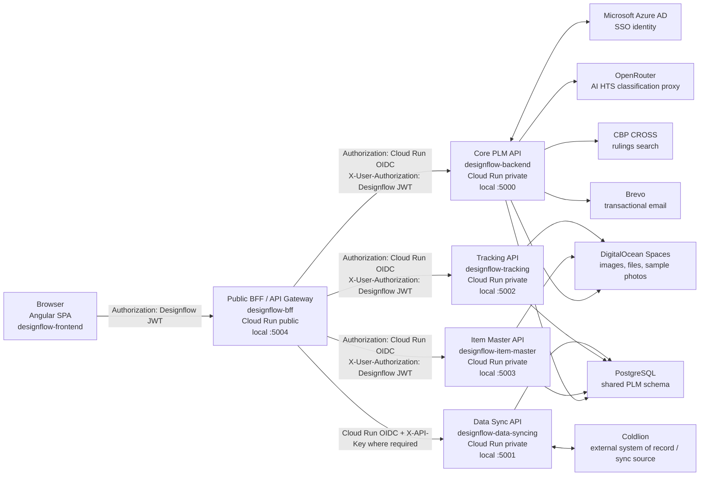
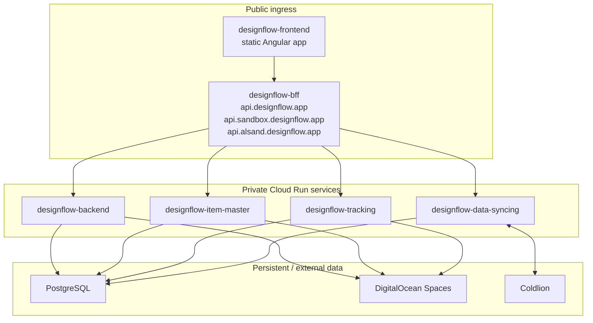
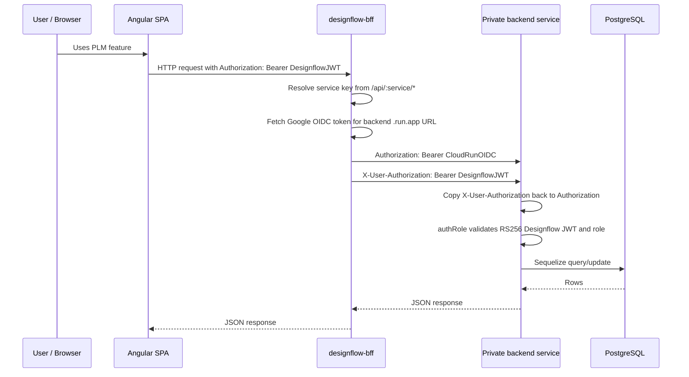
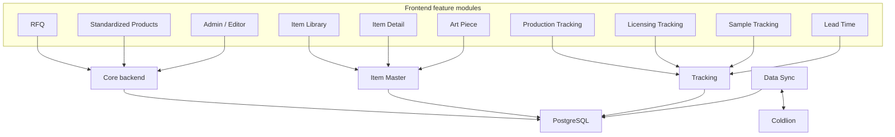

# Designflow PLM System Architecture

> This is a technical system map, not a business-rule authority. Start with the [companywide application and task map](https://github.com/u2giants/shared-db/blob/main/docs/business-rules/application-map.md) for business meaning.

This document maps the Designflow product lifecycle management system across the
local repositories under `D:\repos\dflow`. It is written from the code as it
exists in this workspace, not from the GitHub repo names alone.

The important correction to the informal "five repo" model is that the runtime
PLM system has six active application/service repos locally:

- `designflow-frontend`
- `designflow-bff`
- `designflow-backend`
- `designflow-item-master`
- `designflow-tracking`
- `designflow-data-syncing`

The original five named repos are the main subject, but `designflow-item-master`
is an active service in the request path. The frontend calls it through the BFF,
and the BFF has a first-class `item_master` service mapping. Any complete system
map should include it.

## Executive Summary

Designflow is a Cloud Run based PLM application. The browser runs a static
Angular SPA. The SPA does not call private backend services directly in deployed
environments; it calls the BFF at `api.*.designflow.app`. The BFF proxies each
request to one of the private domain services, adding a Cloud Run OIDC token for
service-to-service invocation while preserving the user's Designflow JWT in
`X-User-Authorization`.

Most services use:

- Node.js CommonJS
- Express
- PostgreSQL
- Sequelize
- `SCHEMA` to select the logical database schema
- RS256 Designflow JWTs for user identity and role checks

The main persistent coupling between services is the shared PostgreSQL schema.
The HTTP/API coupling is intentionally centralized through the BFF.

## High-Level Runtime View



## Public and Private Boundaries



The BFF is intentionally public. The domain services are deployed with
`--no-allow-unauthenticated` and are invoked by the BFF using Cloud Run service
identity. The frontend Cloud Run service is public because it serves the static
SPA.

## Repository Responsibilities

### `designflow-frontend`

The frontend is the Angular 21 SPA. It owns:

- UI routing and feature modules
- Role-based client navigation and route guards
- AG Grid based work surfaces
- RFQ calculation behavior in the browser
- User JWT storage in `localStorage`
- HTTP interceptors for auth, loading, and error reporting
- Microsoft SSO browser flow before exchanging the Azure ID token for a
  Designflow JWT

The deployed frontend calls the BFF, not individual backend services directly.
The environment files define these service bases:

- `environment.url` -> `/api/core`
- `environment.item_master` -> `/api/item_master`
- `environment.tracking` -> `/api/tracking`
- `environment.data_sync` -> `/api/data_sync`

Major user-facing modules:

- RFQ
- Item Library
- Item Detail
- Art Piece management
- Standardized Products
- Production Tracking
- Licensing Tracking
- Sample Tracking
- Lead Time Calculator
- Admin / Editor
- User Management and impersonation
- Notifications
- HTS / tariff / AI classification UI

### `designflow-bff`

The BFF is the public API gateway for the SPA. It owns:

- `/health`
- `/api/:service/*`
- service key mapping
- Cloud Run OIDC identity token generation
- original user JWT forwarding
- deployed CORS configuration

Service keys:

- `core` -> `designflow-backend`
- `item_master` -> `designflow-item-master`
- `tracking` -> `designflow-tracking`
- `data_sync` -> `designflow-data-syncing`

The BFF strips the service prefix before proxying. For example:

```text
Browser:
  GET /api/tracking/sample/list

BFF target:
  GET /sample/list on designflow-tracking
```

Cloud Run OIDC audience must be the backend service `.run.app` URL, not the
custom `api.*.designflow.app` domain. This is why the BFF environment variables
must use backend `.run.app` URLs.

### `designflow-backend`

The core backend executes broad PLM application behavior and shared administration. Companywide
business meaning remains in the Business Logic Library. It is
the densest service and includes both legacy root routes and newer `/api/*`
routes.

It owns:

- Azure SSO token exchange and Designflow JWT issuing
- Password/signup/single-use token flows
- RFQ grid and vendor quote workflows
- RFQ view/grid layout persistence
- Factory/vendor management support
- Customers, item sizes, item depths, delivery locations, FOB countries
- Standardized product APIs
- Comments and audit logs
- Notifications and mention notifications
- Admin app settings
- Tariff management: MFN HTS lookup, Section 301, Trump 2025 rates
- OpenRouter proxy for AI classification
- CBP CROSS proxy
- Brevo transactional email
- DigitalOcean Spaces presign/public URL helpers
- Impersonation tokens

Representative route groups:

- `/auth`
- root legacy RFQ routes such as `/getAllItem`, `/updateRfqItem`,
  `/updateVendor`, `/sendPriceReq`
- `/std`
- `/api/admin`
- `/api/openrouter`
- `/api/cross`
- `/api/comment`
- `/api/notifications`
- `/api/user`
- `/api/customers`
- `/api/grid`
- root DigitalOcean routes such as `/getPreSignedUrl`, `/setObjectPublic`

### `designflow-item-master`

This service is not in the original five-link prompt, but it is wired into the
frontend and BFF as an active service. It owns item master workflows that are no
longer solely in the core backend.

It owns:

- Item Library APIs under `/lib`
- Item Detail APIs under `/detail`
- Art Piece APIs under `/artPiece`
- Item creation and item type lookup
- Product assignment APIs
- Item and art piece media/attachment workflows
- Item detail licensing status helpers

Representative frontend consumers:

- `ItemLibraryService`
- `ItemDetailService`
- `ArtPieceService`

### `designflow-tracking`

Tracking is a separate private service for lifecycle tracking after or around
product/item creation.

It owns:

- Production tracking root routes
- Licensing tracking routes under `/lic`
- Lead-time lookup and calculation under `/lead-time`
- Sample tracking under `/sample`
- Sample events, boxes, groups, comments, photos
- DigitalOcean Spaces upload flow for sample photos
- Startup caches for licensing and factory lead-time calculations

Representative route groups:

- `/getProdOrderHeader`
- `/updateProdOrderHeader`
- `/factoryProdOrders`
- `/factoryProdOrderDates`
- `/syncPrepackAssociations`
- `/lic/getLic`
- `/lic/groups`
- `/lead-time/calculate`
- `/sample/list`
- `/sample/events`
- `/sample/boxes`
- `/sample/photos`

### `designflow-data-syncing`

Data Sync is a private system-to-system integration service for Coldlion sync
flows. It is not a normal user-facing route surface.

It owns:

- Pulling item headers from Coldlion
- Pulling item details from Coldlion
- Pulling merch group headers/details
- Pulling production order headers/details
- Pulling external vendors/customers
- Syncing prepack associations

It uses `X-API-Key: <DFLOW_SYNC_API_KEY>` for every request, including health.
It also has Coldlion API credentials injected through secrets.

## Request and Auth Flow



This dual-token pattern is the key to understanding deployed authentication:

- Cloud Run sees the OIDC token and allows the BFF to invoke the private service.
- Express route guards see the restored user JWT and enforce product roles.

## Deployment Model

Cloud Build builds each repo into a container image and deploys it to Cloud Run.

Public services:

- `designflow-frontend`: public static SPA
- `designflow-bff`: public API entrypoint

Private services:

- `designflow-backend`
- `designflow-item-master`
- `designflow-tracking`
- `designflow-data-syncing`

Common private service deployment traits:

- VPC connector configured
- `--no-allow-unauthenticated`
- DB secrets injected from Secret Manager
- `SCHEMA` injected through environment substitutions

The core backend additionally injects:

- JWT private/public keys
- DigitalOcean Spaces keys
- Brevo API key
- OpenRouter / DeepSeek keys
- Azure client/tenant IDs

The data-sync service additionally injects:

- `DFLOW_SYNC_API_KEY`
- `COLDLION_API_KEY`

## Shared Data Model and Coupling

The services are split by API ownership, but they are strongly connected through
the same database schema. Shared model families include:

- Users, roles, permissions
- Vendors/factories
- Customers
- Merch groups
- UDF tables/elements/components
- Grid layouts and grid access
- Item header/detail/attachments
- RFQ items, groups, vendors, steps, statuses, containers
- Standardized products
- Production order header/detail
- Licensing status/milestone/feed-back/time records
- Sample tracking tables
- External customers/vendors

This means a feature often crosses service boundaries through common table
identifiers even when there is no direct service-to-service HTTP call. For
example, Sample Tracking stores `item_id_fk` and `prod_order_no_fk` links that
connect samples back to item master and production records.

## Feature Area Map



## End-to-End Flows

### Sign-In and Identity

Password login and Microsoft SSO both end by storing a Designflow RS256 JWT in
the browser. For SSO, the browser obtains an Azure ID token, posts it to
`/api/core/auth/azure`, and the core backend verifies Azure JWKS before signing a
Designflow JWT.

Every subsequent browser request sends the Designflow JWT to the BFF.

### RFQ and Vendor Quoting

RFQ is primarily a frontend + core-backend workflow:

1. Frontend loads grid layout and RFQ rows from core backend.
2. Frontend applies AG Grid column definitions and calculation value setters.
3. User edits RFQ item fields or vendor quote fields.
4. Frontend recalculates landed cost, margins, duty, container cost, and sales
   pricing where relevant.
5. Core backend persists RFQ item/vendor changes.
6. Brevo may send quote/signup/request emails.
7. Vendor users access filtered RFQ data through the same BFF/core path.

RFQ list rows should stay light enough for repeated grid use. The list/client
summary payload keeps thumbnail data for visible cells, but the full-size image
URL is fetched only when the user opens the RFQ image editor:
`src/app/pages/rfq/image/image.component.ts` calls
`itemService.getRfqItemImageDetails(rowId)`, which posts to core backend
`/getRfqItemImageDetails` and then opens `imageEditorComponent`. Do not make the
RFQ list eagerly carry `FullSizePicture` again without measuring browser
payload/fetch behavior.

RFQ also reaches into other domains:

- Factory country data is used by tariff calculations.
- Item images/attachments may be stored in DigitalOcean Spaces.
- Grid layouts and view states are shared system metadata.
- Standardized products can export/import to RFQ.

### Item Master and Art Piece

Item Library, Item Detail, and Art Piece screens are frontend modules that route
through `/api/item_master`.

The item-master service owns the active API boundary for these screens. It reads
and writes item master tables, while data-sync can populate or refresh item data
from Coldlion into the same schema family.

### Production and Licensing Tracking

Production and licensing tracking route through `/api/tracking`.

Production tracking works with production order tables and factory-facing order
date updates. Licensing tracking works with licensing status/milestone/grouping
data and item license images. The tracking service builds startup caches for
licensing/factory lead-time calculations.

### Sample Tracking

Sample Tracking is a newer tracking module under `/api/tracking/sample`. It has
its own tables and state machine rather than using `itemHeader` directly as the
primary record. It links to the broader PLM through:

- `item_id_fk`
- `prod_order_no_fk`
- factory/group references
- sample events
- sample boxes
- sample attachments/photos

The server is authoritative for sample status transitions.

### Lead-Time Calculation

The frontend calls `/api/tracking/lead-time/*`. The tracking service uses design
team time, licensing time, factory time, merch group descriptions, and fuzzy
matching helpers to calculate lead time and needed dates.

### HTS, Tariffs, and AI Classification

The frontend duty-rate tools call core backend admin/openrouter/cross routes.

Core backend:

- proxies OpenRouter chat/model calls
- proxies CBP CROSS search
- looks up bundled MFN HTS rates
- manages Section 301 upload/lookup state
- manages Trump 2025 country-rate settings
- stores AI/tariff app settings

The model suggests classification. The system derives actual rates from
authoritative lookup sources and admin-maintained settings.

### Coldlion Sync

Data Sync is the Coldlion integration layer. It is API-key protected and intended
for service/system usage.

It pulls external data into the same database schema used by the application
services. That makes sync a background/source-of-truth feeder for item,
merch-group, vendor/customer, production-order, and prepack-association data.

## Operational Notes

- The app has no single OpenAPI contract across all services.
- Many routes are internal Angular-shaped APIs and return domain rows or
  grid-specific payloads.
- BFF routes are stable as a gateway, but service contracts remain mixed
  legacy/new style.
- The shared database is the strongest cross-service coupling.
  - Historical services still contain startup Sequelize sync/inline DDL, but
    new DB schema/data-contract changes belong in canonical `u2giants/shared-db`
    and must pass the preview-first workflow there.
- JWT is stored in browser `localStorage`, not an HTTP-only cookie.
- DigitalOcean direct browser upload uses a presigned PUT followed by an
  explicit `setObjectPublic` call.

## Canonical Local Ports

| Service | Repo | Local port |
|---|---|---:|
| Frontend | `designflow-frontend` | 4200 |
| BFF | `designflow-bff` | 5004 |
| Core backend | `designflow-backend` | 5000 |
| Data sync | `designflow-data-syncing` | 5001 |
| Tracking | `designflow-tracking` | 5002 |
| Item master | `designflow-item-master` | 5003 |

## Canonical BFF Service Prefixes

| Browser path prefix | Target service |
|---|---|
| `/api/core/*` | `designflow-backend` |
| `/api/item_master/*` | `designflow-item-master` |
| `/api/tracking/*` | `designflow-tracking` |
| `/api/data_sync/*` | `designflow-data-syncing` |

## Where To Change Things

Use this as a first-pass guide:

- Frontend-only layout, grid behavior, labels, navigation: `designflow-frontend`
- RFQ data, vendor quoting, users, roles, admin settings, tariffs, SSO:
  `designflow-backend`
- Item Library / Item Detail / Art Piece APIs: `designflow-item-master`
- Production / licensing / sample / lead-time APIs: `designflow-tracking`
- Coldlion import/sync behavior: `designflow-data-syncing`
- API routing, deployed service target, Cloud Run OIDC forwarding, CORS:
  `designflow-bff`

