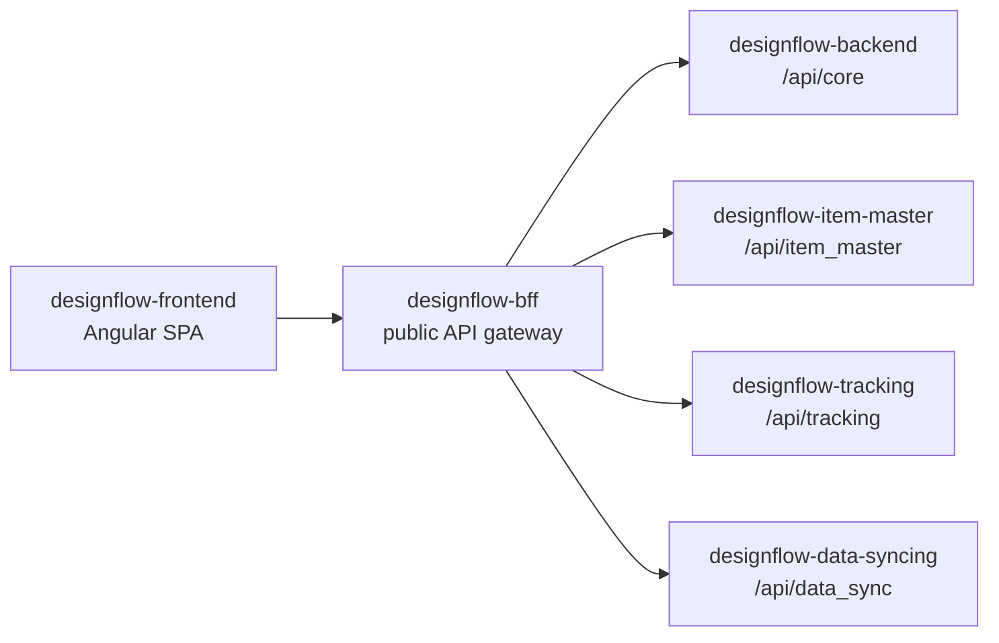

# System Interconnectivity

This frontend is the browser entry point for the Designflow PLM system. It is a
static Angular SPA and does not own persistence. Its job is to assemble the
user-facing workflows and call the correct backend service through the BFF.

## Runtime Position

The environment files define all backend traffic as BFF traffic:

- `environment.url` -> `.../api/core`
- `environment.item_master` -> `.../api/item_master`
- `environment.tracking` -> `.../api/tracking`
- `environment.data_sync` -> `.../api/data_sync`

## Feature-To-Service Map

| Frontend feature | Service base | Backend owner |
|---|---|---|
| RFQ grid, vendor quoting, standardized products, admin, notifications, auth | `environment.url` | `designflow-backend` |
| Item Library | `environment.item_master + '/lib'` | `designflow-item-master` |
| Item Detail | `environment.item_master + '/detail'` | `designflow-item-master` |
| Art Piece | `environment.item_master + '/artPiece'` | `designflow-item-master` |
| Production Tracking | `environment.tracking` | `designflow-tracking` |
| Licensing Tracking | `environment.tracking + '/lic'` | `designflow-tracking` |
| Lead Time Calculator | `environment.tracking + '/lead-time'` | `designflow-tracking` |
| Sample Tracking | `environment.tracking + '/sample'` | `designflow-tracking` |
| Coldlion merch-group stream/sync helpers | `environment.data_sync` | `designflow-data-syncing` |

## Auth and Request Flow

The SPA stores the Designflow JWT in `localStorage`. `UserAuthInterceptor`
attaches it as `Authorization: Bearer <token>` to outgoing API requests. The BFF
then replaces `Authorization` with a Google Cloud Run OIDC token for the private
service and forwards the original user JWT as `X-User-Authorization`.

Backend services restore `X-User-Authorization` to `Authorization` before route
guards run, so the frontend can treat every service request as a normal
user-JWT request.

## Important Couplings

- AG Grid layouts and view states are persisted in backend tables and reused
  across RFQ, item, production, licensing, and admin/editor surfaces.
- RFQ calculations are largely client-side, but persisted through core backend
  RFQ and vendor quote routes.
- RFQ list rows come from `designflow-backend`; vendor quote rows and full-size
  image details can be fetched lazily per RFQ item. The image editor uses
  `/api/core/getRfqItemImageDetails` only when opened, while list rows keep
  thumbnails and avoid carrying every `FullSizePicture` URL.
- Item and art piece workflows depend on `designflow-item-master`, even though
  RFQ and admin workflows live in `designflow-backend`.
- Sample tracking links back to item/production data by identifiers, but its
  state machine is owned by `designflow-tracking`.
- Direct file uploads use presigned URLs from backend services and then PUT
  directly from the browser to DigitalOcean Spaces.

